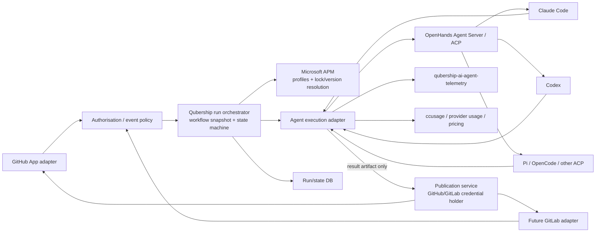
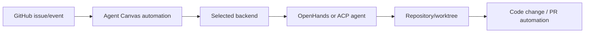
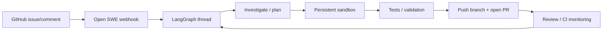
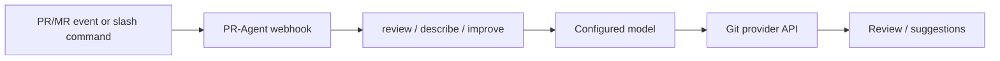
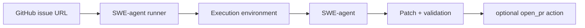
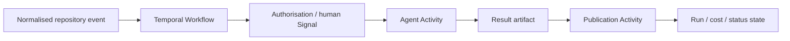

# Qubership Software Factory: Existing-System Research and Build-vs-Extend Assessment

## Research plan and method

The research evaluates F01–F54 and their MUST/SHOULD/MAY priorities. The accompanying comments are context and examples rather than additional mandatory requirements. [requirements](../requirements.md) The research brief requires existing implemented systems to be evaluated before proposing custom development, explicitly distinguishes full coding-agent orchestration systems from narrower automation tools and reusable orchestration components, and requires uncertainty to be preserved rather than inferred away. [research brief](deep-research-brief.md)

Research was performed on **29 October 2026**. The method was to examine current official documentation, repositories, release metadata, implementation documentation and original papers where useful. Static source inspection is treated only as evidence of implemented or documented structure; it is **not** represented as runtime verification.

The research proceeded in five passes:

1. **Landscape discovery.** Candidate systems were sought in three categories: end-to-end software-engineering agent systems, GitHub/GitLab automation applications, and reusable durable-orchestration components. Hosted commercial products were retained only as capability benchmarks where relevant.
2. **Shortlisting.** Five systems were selected for detailed comparison: **OpenHands Agent Canvas**, **Open SWE**, **PR-Agent**, **SWE-agent**, and **Temporal**. The first two are the closest architectural matches; PR-Agent and SWE-agent supply useful implemented review/execution patterns; Temporal is included deliberately as an orchestration component rather than being mischaracterised as a Software Factory.
3. **Requirement mapping.** Every F01–F54 requirement was assessed using five states: **Supported (S)**, **Partial (P)**, **Requires custom development (C)**, **Unsupported by current architecture (U)**, or **Unknown (?)**.
4. **Architecture comparison.** The evidence was used to compare adoption, extension and composition against Qubership's constraints: same-machine primary deployment, GitHub App ingress, future GitLab support, APM-defined profiles, interchangeable harnesses, immutable run configuration, publication-token separation, recovery and cost attribution.
5. **Recommendation.** The final recommendation separates confirmed product facts from architectural inference and proposed Qubership decisions. Where effort or elapsed time is given below, it is a **planning assumption for Qubership integration work**, not an observed vendor benchmark.

A few requirements introduce unusually important architectural tests. In particular, F04 makes Microsoft APM part of the configuration contract; APM itself provides manifests, lockfiles, content hashes and deployment to multiple harness targets, including Claude Code and Codex. [source 1](https://github.com/microsoft/apm?utm_source=chatgpt.com) F22 requires an explicit privilege boundary in which the model does not possess publication credentials. F07 requires an immutable per-run snapshot rather than merely durable workflow code. F30–F33 require harness/model/access-mode compatibility to be explicit and fail closed, including subscription-based authentication. These turn out to be the principal differentiators between "close to the desired product" and "actually satisfies the baseline".

## Executive conclusion

**No examined system satisfies the F01–F54 baseline without material extension. A rewrite from scratch is nevertheless not justified by the evidence.** The strongest direction is a **thin Qubership-owned orchestration/control layer that reuses existing execution, harness, APM, telemetry and pricing components**, rather than adopting an existing coding-agent product wholesale or rebuilding agent execution.

The most consequential development since the likely original framing of these requirements is **OpenHands Agent Canvas**. Its current open-source product is explicitly a self-hosted control centre for coding agents and automations; it can run on an ordinary local machine, in Docker, on remote machines, or against cloud backends. More importantly, it now supports **Claude Code, Codex, Gemini CLI, Pi and OpenCode through ACP**, accepts both provider API credentials and subscription logins, exposes event-driven automations/webhooks, and supports GitHub-oriented issue-to-PR and PR-review automations. [source 2](https://github.com/OpenHands/OpenHands?utm_source=chatgpt.com) This makes it the best **execution/harness substrate** found in the survey and substantially reduces the amount of Qubership-specific agent-launching code that would otherwise be needed.

However, adopting Agent Canvas as the complete Software Factory would still leave central baseline requirements unresolved: there is no evidence of native APM-profile semantics matching F04; arbitrary versioned multi-stage workflow graphs and repeated cycles are not documented at the required level; full immutable F07 run snapshots are not established; F11/F12's unusual authorisation semantics are not native; and the strict F22 result-artifact/publication boundary is not an architectural invariant of Agent Canvas. The OpenHands sources describe the Agent Server as owning external-agent credentials and subprocesses, which is useful, but that is not equivalent to ensuring that an agent cannot ever obtain a GitHub publication credential. [source 3](https://github.com/OpenHands/OpenHands/blob/main/docs/ACP_AGENTS.md?utm_source=chatgpt.com)

**Open SWE** is the closest implemented reference for the *GitHub-facing end-to-end workflow*. It is explicitly described as an open-source software factory: one deployment hosts a FastAPI application, GitHub webhooks and dashboard; it creates a GitHub App; it takes issues through investigation, implementation, validation and PR delivery; it reviews PRs, follows CI and feedback, uses persistent per-thread sandboxes, and builds durable execution on LangGraph. [source 4](https://github.com/langchain-ai/open-swe/blob/main/README.md?utm_source=chatgpt.com) It is therefore highly valuable as an implementation reference and a potential donor architecture. But it has two serious blockers for direct adoption. First, its production deployment currently depends on LangGraph/Managed Deep Agents infrastructure and the standalone LangGraph Agent Server has licensing requirements. Second, its documented GitHub security model normally gives coding sandboxes **installation-wide GitHub App credentials**. [source 4](https://github.com/langchain-ai/open-swe/blob/main/README.md?utm_source=chatgpt.com) That directly conflicts with the security intent of F22 and is expensive to retrofit correctly because publication authority is not merely an adapter at the edge.

**PR-Agent** remains an excellent reusable reference for PR review and Git-provider abstraction. The current community project supports GitHub, GitLab, Bitbucket, Azure DevOps and Gitea; can run through webhooks, Docker, CLI or CI; and supports many LLMs through LiteLLM. [source 5](https://docs.pr-agent.ai/?utm_source=chatgpt.com) Its latest identified release in the research results is v0.41.1, and the project had repository activity in October 2026. [source 6](https://github.com/the-pr-agent/pr-agent/releases?utm_source=chatgpt.com) It is, however, fundamentally a PR automation/review service rather than a general multi-stage software factory.

**SWE-agent** remains useful as an agent-execution and evaluation reference, especially for issue-to-patch execution, containerised environments and research. It can take a GitHub issue and, when configured, open a PR. [source 7](https://github.com/SWE-agent/SWE-agent/blob/main/docs/usage/cl_tutorial.md?utm_source=chatgpt.com) It is not an application-level orchestration framework and would require most of F01–F18, F35–F38 and the publication/security control plane to be built around it.

**Temporal** is not a coding agent and should not be evaluated as one. It is important because it implements several of the hardest generic requirements exceptionally well: durable execution, replay after Worker restart, Signals/Updates for external interaction, long-lived human approval waits, concurrent child workflows, retry/timeout semantics, and Worker Versioning for pinning executions to deployment versions. [source 8](https://docs.temporal.io/best-practices/worker?utm_source=chatgpt.com) Its current server is MIT-licensed and v1.32.1 was the latest release found in the research results, with October 2026 maintenance activity. [source 9](https://github.com/temporalio/temporal/releases?utm_source=chatgpt.com) It is therefore the strongest candidate if Qubership decides that reliable durable orchestration is more important than minimising infrastructure components.

The recommended target is consequently:



This keeps Qubership ownership concentrated on the requirements that are genuinely differentiating: platform-neutral event adapters; allowlist/external-author policy; workflow versioning and immutable run snapshots; human gates; restart semantics; result-artifact validation; publication isolation; compatibility validation; and structured attribution of telemetry and costs. Existing implementations should supply agent runtimes, Git-provider patterns, APM compilation, telemetry collection and price interpretation rather than being rewritten.

## Landscape and shortlist

The systems below are not all in the same category. That distinction is material to the decision.

| Candidate | Category | Deployment | Licence / edition examined | GitHub / GitLab | Harness / model flexibility | Maintenance evidence | Disposition |
|---|---|---|---|---|---|---|---|
| **OpenHands Agent Canvas 1.33.0** | Agent control centre + automation + execution | Local native, Docker, remote/self-hosted Agent Server, optional cloud | MIT for Agent Canvas/core repository; package version 1.33.0 found in current `package.json` | GitHub automation/integration documented; GitLab equivalence not confirmed for current Canvas | OpenHands + Claude Code + Codex + Gemini + Pi + OpenCode + ACP; API and subscription login | Releases and current repository activity in Oct 2026 | **Shortlist; strongest execution substrate**. [source 10](https://github.com/OpenHands/OpenHands?utm_source=chatgpt.com) |
| **OpenHands Cloud self-hosted distribution** | Enterprise product packaging | Kubernetes | PolyForm Free Trial unless commercially licensed | GitHub App | Similar OpenHands stack | Current repository | Do not use as sole base for primary deployment: Kubernetes-heavy and non-open-source licence; useful only as architecture reference. [source 11](https://github.com/OpenHands/openhands-cloud?utm_source=chatgpt.com) |
| **Open SWE 0.1.0 / current main** | End-to-end asynchronous software factory | Local dev; production via LangGraph/Managed Deep Agents or adapted runtime | Open SWE code MIT; `vendor/` explicitly excluded; standalone production dependencies have separate terms | Native GitHub App; no equivalent GitLab application found | Model/sandbox/tools configurable; fixed Deep Agents/LangGraph harness architecture | Actively developed; authors explicitly warn of breaking changes | **Shortlist; strongest GitHub workflow reference, weaker adoption candidate**. [source 12](https://github.com/langchain-ai/open-swe?utm_source=chatgpt.com) |
| **PR-Agent v0.41.1** | PR review/automation application | Docker, CLI, webhook service, CI, self-hosted | Current repo reports MIT; community-maintained | GitHub + GitLab + Bitbucket + Azure DevOps + Gitea | Broad model support through LiteLLM, but one PR-Agent harness | Current release and Oct 2026 activity | **Shortlist; reuse patterns/components, not core orchestration**. [source 13](https://github.com/The-PR-Agent/pr-agent?utm_source=chatgpt.com) |
| **SWE-agent current main** | Coding-agent execution framework / research system | Local/containerised | MIT | Consumes GitHub issue URLs; can create PR; not a GitHub/GitLab application | Multiple LMs; SWE-agent-specific harness | Active issues and PRs in Oct 2026 | **Shortlist; execution/research reference only**. [source 14](https://github.com/SWE-agent/SWE-agent/blob/main/LICENSE?utm_source=chatgpt.com) |
| **Temporal Server v1.32.1** | Durable application orchestration | Self-hosted or cloud | MIT | None natively | Runtime-agnostic | v1.32.1 released Oct 2026; maintained release lines | **Shortlist; strongest generic durable-orchestration component**. [source 9](https://github.com/temporalio/temporal/releases?utm_source=chatgpt.com) |
| **Microsoft APM** | Agent profile/package manager | Local/CI/tooling | Open-source project; current documentation examined | N/A | Targets Claude, Codex, Copilot, Cursor, OpenCode, Gemini and others | Active docs/repository in 2026 | **Mandatory complementary component for F04, not an alternative system**. [source 1](https://github.com/microsoft/apm?utm_source=chatgpt.com) |
| **LiteLLM Proxy** | LLM gateway / cost component | Self-hosted, including air-gapped deployments | OSS + enterprise features | N/A | Broad provider routing | Current 2026 docs | Useful for API-mode routing and API cost capture, but not subscription-harness accounting. [source 15](https://docs.litellm.ai/docs/proxy/cost_tracking?utm_source=chatgpt.com) |
| **GitHub Copilot cloud agent / Agent Control Plane** | Hosted coding-agent platform benchmark | GitHub-managed; agent execution can use self-hosted runners in some configurations | Commercial | GitHub only | Copilot plus third-party Claude/Codex agents | Active 2026 product | Capability benchmark; not suitable as sole Qubership foundation because the agent control plane remains GitHub product infrastructure and is GitHub-specific. [source 16](https://github.blog/changelog/2026-02-26-claude-and-codex-now-available-for-copilot-business-pro-users/?utm_source=chatgpt.com) |
| **Factory** | Commercial agent platform benchmark | Managed platform plus local Droid runtime / enterprise patterns | Commercial | Product integrations | Factory Droid and managed agent estate | Active enterprise product | Useful benchmark for telemetry/governance, not an independently deployable open foundation evidenced here. [source 17](https://docs.factory.com/?utm_source=chatgpt.com) |
| **Codex Cloud / Agents API** | Managed coding-agent service | OpenAI-managed computers | Commercial service | GitHub integration | Codex harness | Current 2026 service | Useful integration benchmark but unsuitable as the sole self-hosted foundation. [source 18](https://help.openai.com/en/articles/20001545-using-codex-cloud?utm_source=chatgpt.com) |

Two architectural observations follow from the landscape.

First, **harness interoperability has improved markedly**. Agent Canvas uses Agent Client Protocol over JSON-RPC/stdio for external coding agents and explicitly supports Claude Code and Codex; its authentication documentation distinguishes existing CLI subscription logins from provider API keys. [source 19](https://github.com/OpenHands/docs/blob/main/openhands/usage/agent-canvas/acp-agents.mdx?utm_source=chatgpt.com) That directly addresses a large part of F29–F32 and makes a Qubership-specific process-launch abstraction less valuable than it would have been previously.

Second, **profile distribution is already becoming a separate infrastructure layer**. Microsoft APM's lockfile pins content versions and hashes, while Qubership's own `qubership-ai-packages` repository already uses APM marketplaces, target-specific compilation and version pinning. [source 20](https://github.com/Netcracker/qubership-ai-packages?utm_source=chatgpt.com) This strongly favours keeping F04 outside whichever workflow engine is chosen.

## Detailed candidate profiles

### OpenHands Agent Canvas

Agent Canvas is currently the best fit for the desired **execution plane**. Its architecture separates a browser control surface from backend Agent Servers. The backend owns conversations, tools, settings, secrets and automations; a workspace may be a local folder, mounted repository or remote sandbox. [source 21](https://github.com/OpenHands/docs/blob/main/openhands/usage/agent-canvas/overview.mdx?utm_source=chatgpt.com) It runs locally without Docker or in a Docker sandbox, and can connect to remote Agent Servers. [source 22](https://github.com/OpenHands/OpenHands?utm_source=chatgpt.com) This aligns closely with F24 and F28: same-machine operation is normal rather than a fallback, while remote workers remain possible.

Its largest advantage is harness support. The documented ACP layer launches Claude Code, Codex, Gemini CLI, Pi and OpenCode as subprocesses; the Agent Server owns the subprocess and its credentials. Subscription logins are automatically reused on a local or self-hosted machine, while API keys can be supplied instead. Claude Code's Pro/Max login and Codex's ChatGPT login are explicitly documented. [source 3](https://github.com/OpenHands/OpenHands/blob/main/docs/ACP_AGENTS.md?utm_source=chatgpt.com) This is unusually close to F29–F32.

The automation subsystem supports scheduled and webhook-triggered work, manual dispatch and run history. Pre-built automations include **Issue to Pull Request**, **GitHub PR Review Assistant** and **GitHub Repository Monitor**. [source 23](https://github.com/OpenHands/extensions/blob/main/skills/openhands-automation/SKILL.md?utm_source=chatgpt.com) The issue-to-PR path is therefore:



The limitations are important. Agent Canvas automation configuration is not documented as a Qubership-style arbitrary stage graph with individually selected harness/model combinations per stage. Editing an automation's LLM or agent profile affects future runs and does not rewrite previous history, which is good evidence of configuration separation, but it does not prove the stronger F07 requirement that every run materialises a complete immutable snapshot of the graph, APM versions, harnesses, models and launch parameters. [source 24](https://github.com/OpenHands/docs/blob/main/openhands/usage/agent-canvas/prebuilt-automations.mdx?utm_source=chatgpt.com)

Similarly, its credential architecture is *better separated than many agent tools* but does not establish the required F22 invariant. The external harness can receive provider credentials, and GitHub automations need publication authority somewhere in the backend. The baseline demands a more explicit boundary: the agent returns an artifact and **only a separate programmatic publisher** may possess publication permissions. That should remain Qubership-owned.

**Assessment:** reuse the Agent Server/ACP execution model if feasible; do not adopt Agent Canvas's automation model unmodified as the canonical Qubership workflow/state model.

### Open SWE

Open SWE is the closest complete analogue to the product concept. It describes itself as an open-source software factory and implements a flow from issue/conversation through planning, coding in an isolated sandbox, validation, PR creation, review, CI monitoring and follow-up work. It supports dashboard, GitHub, Slack and scheduled starts. [source 25](https://github.com/langchain-ai/open-swe/blob/main/README.md?utm_source=chatgpt.com)

The deployment consists of a LangGraph server, FastAPI web application, webhook handling and dashboard at one origin. The documented GitHub installation uses a proper GitHub App with repository permissions and webhook subscriptions including issue comments, PR reviews, check runs and workflow runs. [source 26](https://github.com/langchain-ai/open-swe/blob/main/docs/INSTALLATION.md?utm_source=chatgpt.com) This is strong evidence for F01, F13, F14 and F16-like capabilities.

Its state model is also stronger than most coding-agent products. LangGraph supplies durable execution and thread state, while coding work can use persistent per-thread sandboxes; follow-up coding work can reuse thread context and sandbox state. [source 25](https://github.com/langchain-ai/open-swe/blob/main/README.md?utm_source=chatgpt.com) Subagents provide parallel investigation. This is directly relevant to F18, F35, F36, F47 and F48.

The end-to-end path is:



The largest blocker is security architecture. Open SWE explicitly states that coding sandboxes normally receive **installation-wide GitHub App access**, with workspace bindings controlling routing rather than creating a separate credential boundary. [source 4](https://github.com/langchain-ai/open-swe/blob/main/README.md?utm_source=chatgpt.com) That is not a small mismatch with F22; the intended Qubership design makes the absence of publication credentials from the model environment a hard requirement. Correcting this would require redesigning mutation paths around signed result artifacts or narrow RPC tools, not merely changing configuration.

Open SWE also uses its own agent/runtime model rather than interchangeable coding harnesses. Models, tools and sandboxes can be customised, but this is not equivalent to F32's requirement to run Claude Code and Codex harnesses independently. Its production installation currently depends on LangGraph Agent Server/Managed Deep Agents arrangements, and the project itself cautions that it is evolving quickly and may contain breaking changes. [source 27](https://github.com/langchain-ai/open-swe/?utm_source=chatgpt.com)

**Assessment:** strongest architecture and workflow reference; a less attractive direct foundation than Agent Canvas once F22 and harness interchangeability are weighted as MUSTs.

### PR-Agent

PR-Agent is deliberately narrower. It receives a PR URL or webhook event and runs tools such as describe, review, improve and ask. It supports GitHub, GitLab, Bitbucket, Azure DevOps and Gitea, including self-hosted GitHub Enterprise and GitLab instances. [source 28](https://docs.pr-agent.ai/?utm_source=chatgpt.com) It therefore has highly relevant implementation patterns for F02, F13–F17 and F39.

Its strongest architectural asset is the **Git-provider abstraction**. Qubership needs shared workflow logic behind GitHub/GitLab adapters; PR-Agent is evidence that this division is practical in a maintained implementation. Its second useful asset is provider breadth through LiteLLM. [source 29](https://github.com/The-PR-Agent/pr-agent?utm_source=chatgpt.com)

The supported end-to-end path is PR-focused rather than issue-to-PR:



It does **not** provide the desired general workflow model, durable multi-stage issue development, session coordination or harness interchangeability. Publication and model execution live within the same application trust domain, so it does not meet F22 as written. Configuration can be central, but PR-Agent also supports repository-local `.pr_agent.toml`, which would not be the desired primary configuration mechanism for Qubership. [source 30](https://docs.qodo.ai/qodo-documentation/code-review/get-started/configuration-overview/configuration-file?utm_source=chatgpt.com)

**Assessment:** do not build the Software Factory around PR-Agent; reuse or copy its provider abstraction, PR diff/review logic and cross-platform webhook experience where licence and code fit.

### SWE-agent

SWE-agent is primarily an execution/research framework. Its canonical task is to take a GitHub issue and have an LM operate on a repository to produce a fix; its CLI can optionally open a PR when the issue is solved. [source 31](https://github.com/swe-agent/swe-agent?utm_source=chatgpt.com) The project is MIT-licensed, and active issues and pull requests were visible in October 2026. [source 32](https://github.com/SWE-agent/SWE-agent/blob/main/LICENSE?utm_source=chatgpt.com)

The issue-to-PR route is thus real, but it is CLI-oriented:



SWE-agent provides useful practices around agent-computer interfaces, containerised environments, trajectories and model experimentation. Its original paper is also useful as primary evidence of the design motivation and evaluation methodology. [source 33](https://arxiv.org/abs/2405.15793?utm_source=chatgpt.com)

It is nevertheless far from the application contract. A GitHub App, event authorisation, durable state machine, human checkpoints, multiple workflow selection, external-author filtering, publication separation and persistent issue-session ownership all have to be supplied around it.

**Assessment:** retain as an execution/evaluation reference and possibly for specialised research workflows; do not choose it as the main orchestration platform.

### Temporal

Temporal supplies no coding-agent functionality. It instead provides a durable workflow kernel in which application Workflows are event-sourced and replayed; Workers may restart and executions continue from persisted event history. [source 34](https://docs.temporal.io/tasks?utm_source=chatgpt.com) Signals and Updates provide explicit external control, making human approvals straightforward, and Temporal documents durable AI flows that can wait days for approval and continue after crashes. [source 35](https://docs.temporal.io/encyclopedia/workflow-message-passing?utm_source=chatgpt.com)

Temporal Worker Versioning can pin a Workflow Execution to a Worker Deployment Version. [source 36](https://docs.temporal.io/best-practices/worker?utm_source=chatgpt.com) This is not sufficient by itself for F07 because Qubership also requires an immutable copy of APM versions, harness/model choices and launch parameters, but it solves the more subtle problem of keeping code compatible with an already-running workflow.

A Qubership mapping would look like:



The trade-off is operational weight. A full Temporal Service is a substantial additional subsystem compared with an application DB plus an explicit state machine. Temporal documentation itself provides a production-readiness checklist for self-hosted operation, reflecting that this is real infrastructure rather than a library-level convenience. [source 37](https://docs.temporal.io/self-hosted-guide/production-checklist?utm_source=chatgpt.com)

**Assessment:** choose Temporal if durable workflow correctness, multi-day human waits and future distributed workers justify operating a workflow service. For the initial same-machine deployment, a smaller explicit state machine backed by PostgreSQL/SQLite can satisfy the same product requirements with less infrastructure, provided F07/F18/retry/idempotency semantics are carefully implemented and tested.

## Requirements coverage matrix

### Matrix interpretation and evidence basis

The shorthand below means:

- **S** — implemented support is directly evidenced and materially matches the requirement.
- **P** — a substantial portion is implemented, but a meaningful part of the requirement is absent or unverified.
- **C** — achievable by building an adapter or new Qubership capability around the system.
- **U** — the current architecture conflicts with the requirement or the feature is outside its intended model.
- **?** — insufficient primary evidence.

The table describes **current evidence, not hypothetical extensibility**.

For OpenHands, the evidence basis is Agent Canvas 1.33.0/current documentation: local and remote Agent Servers, automations, GitHub-oriented templates, ACP agents and subscription/API authentication. [source 38](https://github.com/OpenHands/OpenHands?utm_source=chatgpt.com)

For Open SWE, the basis is current main / package version 0.1.0 and its installation/customisation architecture: GitHub App webhooks, LangGraph durability, persistent sandboxes, subagents and the documented installation-wide GitHub credential model. [source 39](https://github.com/langchain-ai/open-swe/blob/main/README.md?utm_source=chatgpt.com)

For PR-Agent, the basis is v0.41.1/current community repository and official PR-Agent documentation, including webhook/self-hosted deployment, provider abstraction and broad LLM support. [source 40](https://docs.pr-agent.ai/?utm_source=chatgpt.com)

For SWE-agent, the basis is current main, its documented issue-to-PR CLI flow, MIT repository and active Oct 2026 development. [source 41](https://github.com/SWE-agent/SWE-agent/blob/main/docs/usage/cl_tutorial.md?utm_source=chatgpt.com)

For Temporal, the basis is server v1.32.1 documentation covering durable execution, Signals/Updates, retries and Worker Versioning. [source 42](https://github.com/temporalio/temporal/releases?utm_source=chatgpt.com)

| ID | Priority | Requirement shorthand | OpenHands Canvas | Open SWE | PR-Agent | SWE-agent | Temporal |
|---|---|---|---|---|---|---|---|
| F01 | MUST | GitHub App events launch agents | **P** GitHub event automation exists; exact self-hosted App path needs validation | **S** native GitHub App + webhook | **S** GitHub App/webhook mode | **C** CLI must be wrapped | **C** ingress custom |
| F02 | MUST | GitHub + GitLab from one codebase; enterprise self-host | **P** current Canvas GitLab parity unconfirmed | **C** GitHub-centric | **S/P** both provider adapters and self-hosting, but not full factory | **C** | **C** |
| F03 | MUST | Central workflow changes without repo changes | **S** backend automation config | **S** workspace/server config | **S/P** central config possible, though repo config also common | **S/P** external configs | **S** workflow deployment independent of target repos |
| F04 | MUST | Complete profiles stored/loaded as APM packages | **C** | **C** | **C** | **C** | **C** |
| F05 | MUST | Configurable agents/stages/cycles; independent harness/model | **P** independent harness support, but arbitrary multi-stage graph not evidenced | **P** graph/subagents and models, not interchangeable harness per stage | **U** no general workflow graph | **P** configurable agent execution, not factory graph | **S/P** arbitrary workflows; agent/harness semantics custom |
| F06 | MUST | Arbitrary workflows + manual/automatic selection | **P** multiple automations/manual dispatch | **P** multiple graph entry points/triggers, not arbitrary configured workflow catalogue | **U** | **C** | **S/P** arbitrary workflow types; selector custom |
| F07 | MUST | Versioned workflow + immutable start snapshot | **P** future edits do not rewrite run history; full snapshot unverified | **P** durable thread state; complete immutable launch snapshot unverified | **C** | **P/C** trajectories/config exist but not this contract | **P** execution/code versioning strong; Qubership snapshot fields custom |
| F08 | MUST | Configurable human review stages | **C/P** human interaction exists, arbitrary gates unverified | **P** approval mechanisms exist but are not arbitrary stage gates | **C** | **C** | **S** durable Signals/Updates are strong basis |
| F09 | SHOULD | Multiple workflows per repo parallel/sequential | **P** multiple automations/backends | **P** concurrent threads/subagents | **C** | **C** | **S** child workflows/concurrency |
| F10 | SHOULD | Persist workflow status in Git labels | **C** | **C** | **C** | **C** | **C** |
| F11 | MUST | Participant allowlists; ignore non-allowlisted opinions | **C** | **P/C** org authorisation exists; strict commenter exclusion custom | **C** | **C** | **C** |
| F12 | MUST | Do not process external-author PRs | **C** | **C** | **C** | **C** | **C** |
| F13 | SHOULD | GitHub App permissions, no repo CI files | **S/P** GitHub integration available; exact self-host mode to verify | **S** | **S** webhook App mode | **C** | **C** |
| F14 | MAY | REST API for events/job launch | **S** automation API | **S** FastAPI/API | **S** webhook server | **C** | **S/P** client API, GitHub endpoint custom |
| F15 | MAY | Separate GitHub/GitLab endpoints to shared handler | **C/P** | **C** | **S/P** provider abstraction implemented | **C** | **C** |
| F16 | MAY | Run on PR/MR creation/new commits | **S** event automations | **S** PR/check/webhook triggers | **S** | **C** | **C** |
| F17 | MAY | Filter before model call | **S/P** deterministic script bundles can front agent work | **S/P** trigger/middleware logic | **S** webhook trigger filtering patterns | **C** | **S/P** activity can be skipped deterministically |
| F18 | MUST | Resume unfinished runs after restart | **P** persistent backend/conversations; automatic automation resume not proven | **P/S** LangGraph durable state; exact restart behaviour deployment-dependent | **U/P** largely request-oriented | **U** no durable factory state | **S** core property |
| F19 | MAY | SQLite or cloud DB for run state | **P** persistent backend state; exact store deployment-dependent | **S/P** platform/Postgres-style persistence | **C** | **C** | **S** persistent DB-backed service, not specifically SQLite |
| F20 | MAY | Use local GitHub mirror | **C** | **C** | **C** | **C** | **C** |
| F21 | MAY | Duplicate detection via local mirror | **C** | **C** | **C** | **C** | **C** |
| F22 | MUST | Agent artifact + separate publisher; no publication token to model | **C** not a documented invariant | **U** sandbox normally gets GitHub App credentials | **U** same application trust domain | **U/C** open-PR action not separated as required | **C** excellent orchestration boundary, publisher still custom |
| F23 | MUST | Cache clones and prepared environment | **P** workspaces/worktrees reused; exact clone-cache contract not proven | **P/S** persistent per-thread sandboxes/preloaded repo | **U** API/diff-oriented, not clone-cache worker | **P** clone/env optimisation exists; cross-job cache contract unverified | **C** |
| F24 | MUST | Same-machine workers | **S** local backend first-class | **S** local execution possible | **S** Docker/local | **S** local runner | **S** local Worker |
| F25 | SHOULD | Do not publish debug/internal journals | **P/S** user-facing automation output separated from internal history | **P/S** | **S** review output distinct from process logs | **S/P** trajectories remain local | **C** |
| F26 | SHOULD | Multiple related repos in one worker job | **P** workspace can expose multiple project folders; integration semantics custom | **P** configurable workspace/tooling, explicit multi-repo job unverified | **U** | **P/C** custom task possible | **C** |
| F27 | MAY | Issue/PR job status | **P** run history + integrations; exact Git status mapping custom | **S** check-run/status integration | **P** | **C** | **C** |
| F28 | MAY | Independent remote workers | **S** remote Agent Server/backend | **S** sandbox providers | **C** | **C/P** remote execution environments possible | **S** distributed Workers |
| F29 | MUST | Default multimodel harness replaceable by another | **S** OpenHands + interchangeable ACP harnesses | **P/U** multimodel agent but fixed harness architecture | **P** multimodel, fixed PR-Agent harness | **P** multimodel, fixed SWE-agent harness | **C** |
| F30 | MUST | API or subscription model access | **S** both explicitly supported | **P** API/provider path; subscription-harness mode not equivalent | **P** API-centric | **P** API-centric | **C** |
| F31 | MUST | Secure credential storage/release only to authorised components | **P** Agent Server owns agent credentials; complete Qubership boundary not guaranteed | **P/U** broad GitHub App access to coding sandboxes conflicts with least privilege | **P** secrets supported but Git + model privileges share process trust | **P** runner/env secrets | **C/P** application can implement with external secret manager |
| F32 | MUST | Claude Code and Codex harnesses | **S** explicitly supported | **U** | **U** | **U** | **C** |
| F33 | MUST | Validate harness/model/access compatibility, fail without substitution | **P** provider/backend capability checks exist; exact Qubership compatibility matrix custom | **C** | **C** | **C** | **C** |
| F34 | MAY | API router/proxy | **S** OpenAI-compatible gateways including LiteLLM | **S/P** provider abstraction configurable | **S** LiteLLM | **S/P** broad model provider layer | **C** |
| F35 | SHOULD | Agents/sessions exchange messages and coordinate commits | **P** parallel agents/worktrees; explicit agent-agent protocol unproven | **S/P** subagents coordinate within workflow | **U** | **U** | **P** workflow messaging supports it but agent semantics custom |
| F36 | SHOULD | Reuse issue's main agent session/context | **S/P** persistent conversations; issue ownership mapping custom | **S** follow-up work reuses thread context/sandbox | **U** | **U** | **C** |
| F37 | SHOULD | Standard labels/commands control execution | **C/P** webhook automations can implement deterministic controls | **S** command-style triggers such as `/baby-sit` | **S** slash commands | **C** | **C** |
| F38 | MAY | Issue development: plan, code, branch, PR + configured approvals | **P/S** issue-to-PR template; arbitrary approval stages custom | **S/P** full issue-to-PR; approval model narrower | **U** | **P** issue-to-PR but no configurable human gates | **C** |
| F39 | SHOULD | PR review with code analysis and tests | **S** PR Review automation; tests via agent workspace | **S** | **S/P** strong review; execution depth depends configuration | **P** custom review task possible | **C** |
| F40 | SHOULD | Scope defects vs incidental findings | **C** prompt/profile policy | **P** review architecture supports targeted review; exact rule prompt-dependent | **S/P** PR-scoped review by design, exact classification policy prompt-dependent | **C** | **C** |
| F41 | MAY | Auto-merge Renovate PR | **C** | **C** | **C** | **C** | **C** |
| F42 | MAY | Reproduce bug before fix | **C** workflow/profile instruction | **P/C** agent can investigate/reproduce, policy custom | **U** | **S/P** execution agent can reproduce when prompted | **C** |
| F43 | MAY | Analyse PR review comments and prepare responses | **C/P** automation can be defined | **S** feedback/follow-up work implemented | **P/S** PR comment interaction implemented | **C** | **C** |
| F44 | MAY | Create issues for out-of-scope defects | **C** | **C** | **C** | **C** | **C** |
| F45 | MAY | Review abstraction level | **C** profile/prompt | **C** | **P/C** custom review instructions | **C** | **C** |
| F46 | MAY | Detect standard/widely used library duplication | **C** | **C** | **P/C** custom review | **C** | **C** |
| F47 | MAY | Research workflow before implementation | **P** general automations + agents | **P/S** investigation/subagents | **U** | **P** arbitrary tasks | **C** |
| F48 | MAY | Research subagents with different prompts | **C/P** multiple agents possible; orchestration custom | **S** subagent primitive | **U** | **U/C** | **C** |
| F49 | MAY | Search codebase for same defect class | **C** | **C/P** broad repository investigation possible | **C** | **C/P** agent can perform search when instructed | **C** |
| F50 | MAY | Use fixed bugs/examples/embeddings | **C** | **P** learns from historical review feedback; bug-embedding system not evidenced | **C** | **C** | **C** |
| F51 | MAY | Distinct review-subagent personas | **C** | **C/P** subagents exist; persona orchestration custom | **U/C** | **C** | **C** |
| F52 | MUST | Every agent emits qubership or native telemetry | **C/P** telemetry/observability exists but Qubership guarantee custom | **S/P** LangSmith tracing is integral/default, Qubership integration still custom if required | **C** | **C/P** trajectories are not equivalent to required telemetry | **C** |
| F53 | MUST | Actual API cost + separately estimated subscription cost per run/PR | **C** | **C** | **P/C** API usage/cost possible; subscription estimate absent | **P/C** model cost exists in execution tooling, not full dual accounting | **C** |
| F54 | SHOULD | Store API and subscription costs as separate numeric fields | **C** | **C** | **C** | **C** | **S/P** trivial durable structured state, attribution custom |

### MUST blockers

The matrix makes five MUST clusters decisive.

**APM profiles — F04.** None of the five shortlisted systems natively implements the requirement as written. This should not be interpreted as evidence for custom package management: Microsoft APM already provides package manifests, target deployment and exact lockfile content pinning, and Qubership already has an APM marketplace. [source 20](https://github.com/Netcracker/qubership-ai-packages?utm_source=chatgpt.com) The missing work is the **orchestration adapter** that resolves and snapshots APM package versions before launch.

**Run immutability — F07.** Temporal best addresses workflow-code durability; Open SWE best addresses durable agent thread state; neither on its own records the exact Qubership run contract. The run record therefore needs a first-class immutable `RunSnapshot` containing the resolved workflow version, stage graph, APM lock/package hashes, harness ID/version, model ID, access method, provider endpoint identifier, repository/revision, launch arguments and policy version.

**Publication isolation — F22.** This is the strongest reason not to adopt Open SWE wholesale. Open SWE's documented use of installation-wide GitHub credentials in coding sandboxes contradicts the desired trust boundary. [source 4](https://github.com/langchain-ai/open-swe/blob/main/README.md?utm_source=chatgpt.com) OpenHands is easier to place behind a result-artifact boundary, but the boundary still has to be enforced by Qubership.

**Harness + access-mode contract — F29–F33.** Agent Canvas is the only shortlisted system with direct implemented evidence for both Claude Code and Codex as external harnesses and for subscription-login/API-key access. [source 19](https://github.com/OpenHands/docs/blob/main/openhands/usage/agent-canvas/acp-agents.mdx?utm_source=chatgpt.com) This is the strongest concrete argument for reusing its Agent Server/ACP layer.

**Telemetry and dual cost accounting — F52–F53.** No shortlisted factory implements the exact Qubership requirement. However, most underlying pieces already exist. `qubership-ai-agent-telemetry` documents unattended agent integration and normalised telemetry ingestion. [source 43](https://github.com/Netcracker/qubership-ai-agent-telemetry?utm_source=chatgpt.com) `ccusage` now supports multiple coding-agent CLIs including Claude Code and Codex and estimates costs from token/model usage; for Claude Code it can use pre-calculated values when present or pricing-derived values otherwise. [source 44](https://ccusage.com/guide/?utm_source=chatgpt.com) LiteLLM records API spend as structured USD values when calls pass through its proxy. [source 45](https://docs.litellm.ai/docs/proxy/cost_tracking?utm_source=chatgpt.com) The orchestration layer therefore needs attribution and reconciliation more than it needs a new pricing engine.

## Architecture options and prioritised recommendation

### Option comparison

| Option | What it reuses | What remains custom | Fit with deployment constraints | Principal risk | Recommendation |
|---|---|---|---|---|---|
| **Adopt OpenHands Agent Canvas as whole product** | Local/remote execution, ACP harnesses, subscription/API auth, automation UI/server | APM semantics, strict workflow snapshots, allowlist/external-author policy, GitLab parity, publisher boundary, exact cost model | Very good same-machine fit | Product automation model may fight F05–F08/F22 | **Viable only if requirements are relaxed; not preferred** |
| **Extend Open SWE** | GitHub App, issue-to-PR, review, CI monitoring, durable threads, subagents, web UI | GitLab, APM, Claude/Codex harness adapters, F07 snapshots, major F22 credential-boundary redesign | Local dev good; production dependency/licensing/operational model less aligned | Security redesign touches core architecture | **Not preferred as primary base** |
| **Compose OpenHands execution + Qubership orchestration** | ACP/Agent Server, harness auth, workspaces; Microsoft APM; telemetry; ccusage/LiteLLM | Event adapters, workflow state, snapshots, approvals, publisher, authorisation, attribution | Excellent | Integration/version compatibility across components | **Preferred** |
| **Compose Temporal + OpenHands execution** | Same as above plus durable workflow engine | Domain adapters and policies | Strongest recovery/scaling; heaviest local stack | Operational overhead | **Preferred if durable orchestration complexity is expected early** |
| **Build everything custom** | APM/telemetry perhaps | Eventing, orchestration, execution, harness auth, workspaces, recovery, provider routing, publisher | Can fit perfectly | Duplicates mature harness/runtime work and increases security surface | **Reject** |

### Recommended responsibility split

**Qubership-owned orchestration/control plane**

This should own the GitHub App and future GitLab application adapters, event normalisation, participant/author checks, F12 external-author exclusion, workflow catalogue and selection, immutable `RunSnapshot`, workflow-state transitions, human-review gates, cancellation/retry policy, status labels, result validation, run/PR mapping, publisher calls and structured cost attribution.

This is where the product's differentiating policy resides. It is also the only sensible place to implement F11, because the requirement goes beyond ordinary access control: content from non-allowlisted commenters must not enter the agent's work context.

**Execution plane: reuse before writing**

Use OpenHands Agent Server/ACP or directly reuse its ACP integration patterns for Claude Code, Codex, Pi and OpenCode. Agent Canvas's published ACP architecture already solves subprocess management and subscription/API credential discovery across these harnesses. [source 3](https://github.com/OpenHands/OpenHands/blob/main/docs/ACP_AGENTS.md?utm_source=chatgpt.com) A Qubership `HarnessAdapter` should wrap this with an explicit compatibility registry:

```text
(harness, harness_version, model, access_mode, provider) -> supported | unsupported
```

No implicit fallback should exist. That directly implements F33.

**Profile distribution: Microsoft APM**

At run start, resolve the requested APM package set, verify the lockfile/hashes, materialise the harness target and record exact package identifiers/hashes in the `RunSnapshot`. APM already provides deterministic lockfile semantics and target-specific deployment. [source 46](https://microsoft.github.io/apm/?utm_source=chatgpt.com) Do not copy an APM bundle into the connected repository merely to make orchestration convenient; F03/F04 explicitly make profile configuration independent of repository configuration.

**Publication plane: custom, deliberately small**

Treat model/harness output as an untrusted **result artifact**. A publisher service validates a schema such as:

```text
RunResult
  run_id
  repository
  base_revision
  expected_head_revision
  artifact_type
  proposed_comment
  patch_or_branch_reference
  requested_actions[]
```

Only that service receives GitHub/GitLab publication credentials. It should re-check authorisation and revision before every mutating action. This also creates a natural place for duplicate-publication protection and idempotency keys.

**Telemetry/cost plane: compose existing tools**

Every launch should inject Qubership telemetry hooks where supported or consume harness-native telemetry and normalise it. `qubership-ai-agent-telemetry` already supports agent hook integration and unattended endpoint configuration. [source 47](https://github.com/Netcracker/qubership-ai-agent-telemetry/blob/main/docs/agent-integration.md?utm_source=chatgpt.com)

For API-based calls, provider invoice/response usage or a controlled LiteLLM gateway can supply **actual API spend**; LiteLLM records per-request spend and model usage, but its documentation also cautions that observed spend capture can diverge when requests bypass the gateway or pricing maps lag provider changes. [source 48](https://docs.litellm.ai/docs/proxy/cost_tracking?utm_source=chatgpt.com) Therefore gateway-calculated cost should not automatically be labelled "actual" unless reconciled to the provider's authoritative billing data.

For subscription sessions, `ccusage` is well suited to the separate **estimated API-equivalent/subscription-run cost** field because it now understands several coding-agent CLIs and uses token/model pricing. [source 49](https://ccusage.com/guide/?utm_source=chatgpt.com) The requirement should retain separate columns such as:

```text
actual_api_cost_usd
estimated_subscription_cost_usd
cost_source
pricing_snapshot_id
usage_input_tokens
usage_output_tokens
usage_cache_tokens
```

This avoids mixing a flat subscription payment with a hypothetical per-token value.

### Durable orchestration choice

There are two reasonable implementations of the Qubership state machine.

**Smaller initial design:** application service + relational DB. Each run and stage is persisted before work begins; transitions use optimistic locking; queued/running stages are recovered on startup; publisher actions carry idempotency keys; worker leases expire; retry counters and attempt records are durable. This minimises deployment complexity and is a good match for the "ordinary same machine" primary topology.

**Temporal-backed design:** represent each run as a Temporal Workflow, each agent stage/publication as Activities, approvals as Signals/Updates and parallel stages as child Workflows. Temporal naturally handles replay and long waits, and Worker Versioning keeps existing executions on compatible code. [source 50](https://docs.temporal.io/best-practices/worker?utm_source=chatgpt.com) This becomes more attractive if many independent workers, days-long workflows, sophisticated retry semantics or high-volume concurrent orchestration become early requirements.

The current baseline does **not** specify scale in enough detail to justify Temporal as mandatory. "Hundreds of repositories" appears in contextual discussion, but event rate, simultaneous run count, recovery RTO and availability target are unspecified. [requirements](../requirements.md) Therefore the recommendation is to keep the orchestration interface Temporal-compatible but begin with a database-backed state machine unless load/reliability experiments demonstrate a need for a dedicated workflow service.

### Prioritised implementation recommendations

| Priority | Recommendation | Reuse vs custom | Rationale | Planning effort assumption | Risk |
|---|---|---|---|---|---|
| **P0** | Build immutable run/snapshot and policy model | Custom | No candidate supplies F07/F11/F12 exactly | 2 engineers, roughly 3–5 weeks | Medium; schema mistakes become hard to migrate |
| **P0** | Integrate OpenHands Agent Server/ACP for Claude Code + Codex first | Reuse + adapter | Best direct evidence for F29–F32 | 1–2 engineers, roughly 2–4 weeks | Medium; upstream ACP/API changes |
| **P0** | Build separate publisher with zero model publication credentials | Custom | F22 is not met by candidates and is a core security invariant | 1–2 engineers, roughly 2–3 weeks | High security impact, low conceptual complexity |
| **P0** | Integrate APM resolution/snapshotting | Reuse + adapter | Avoids inventing profile packaging; directly meets F04 intent | 1 engineer, roughly 1–2 weeks | Low–medium |
| **P0** | Implement GitHub App adapter, webhook verification, authorisation and external-author policy | Custom using PR-Agent/Open SWE patterns | Product-specific semantics | 1–2 engineers, roughly 3–5 weeks | High security impact |
| **P1** | Persist workflow state and restart recovery | Custom DB state machine initially | F18; same-machine deployment does not require Temporal immediately | 1–2 engineers, roughly 3–5 weeks | Medium–high; requires failure testing |
| **P1** | Integrate telemetry and dual cost accounting | Reuse + attribution layer | Existing telemetry/ccusage/LiteLLM cover collection/pricing pieces | 1 engineer, roughly 2–4 weeks | Medium; price freshness and attribution |
| **P1** | GitHub issue-to-PR + review workflows | Custom workflow definitions over reused executor | Can borrow Open SWE flow without its credential model | 2 engineers, roughly 3–6 weeks after foundation | Medium |
| **P2** | GitLab adapter | Custom adapter; borrow PR-Agent provider patterns | Required architecturally, but release timing unspecified | 1–2 engineers, roughly 3–5 weeks | Medium; GitHub/GitLab semantic differences |
| **P2** | Remote worker support | Reuse Agent Server or add worker RPC | MAY requirement and architecture already supports later addition | 1–2 engineers, roughly 2–4 weeks | Medium |
| **P2** | Temporal migration/option | Reuse | Only if operational evidence justifies it | 2 engineers, roughly 3–6 weeks beyond base state machine | Medium operational complexity |

These are **planning estimates**, not evidence of implementation velocity in any candidate. They assume an experienced team, substantial automated test coverage, one primary language/runtime, and that the components expose stable enough APIs for integration. The authoritative files provide no team size, SLA, concurrent-run target, deployment OS, required database, security-certification target or delivery deadline, so those parameters are **unspecified**. [requirements](../requirements.md)

Under those assumptions, a coherent first production-quality baseline covering the major MUSTs is roughly a **three- to five-month programme for a four-person engineering team plus part-time security/SRE review**, with GitLab and advanced MAY workflows potentially following. This is a decomposition-based planning range, not a benchmark. A hands-on spike could materially change it, especially if Agent Server APIs or APM compilation are harder to embed than the static documentation suggests.

## Sources, assumptions, unknowns and evidence gaps

### Primary source catalogue

The source set intentionally favours official repositories, documentation, standards and original papers.

**Authoritative Qubership inputs.** The F01–F54 baseline and contextual comments come from `requirements-snapshot.md`. [requirements](../requirements.md) The required decision method, candidate seeds and report constraints come from `prompt.md`. [research brief](deep-research-brief.md)

**OpenHands.** The current OpenHands repository documents Agent Canvas as a self-hosted coding-agent control centre with local/remote backends, event automations and ACP-compatible agents. [source 22](https://github.com/OpenHands/OpenHands?utm_source=chatgpt.com) Its ACP documentation details Claude Code, Codex, Gemini, Pi and OpenCode commands, credential ownership and subscription/API authentication. [source 3](https://github.com/OpenHands/OpenHands/blob/main/docs/ACP_AGENTS.md?utm_source=chatgpt.com) Current automation documentation describes webhook APIs, manual dispatch and pre-built issue-to-PR and PR-review automations. [source 23](https://github.com/OpenHands/extensions/blob/main/skills/openhands-automation/SKILL.md?utm_source=chatgpt.com) The current package metadata identifies Agent Canvas 1.33.0 and MIT licensing. [source 51](https://github.com/OpenHands/OpenHands/blob/main/package.json?utm_source=chatgpt.com) The original OpenHands paper provides the research background for the open software-agent platform. [source 52](https://arxiv.org/abs/2407.16741?utm_source=chatgpt.com)

**Open SWE.** The official repository describes an open-source software factory built on Deep Agents/LangGraph, including issue-to-PR, review, CI monitoring, persistent threads and subagents. [source 25](https://github.com/langchain-ai/open-swe/blob/main/README.md?utm_source=chatgpt.com) Its installation guide documents one-deployment architecture, GitHub App permissions/webhooks and its repository trust model. [source 26](https://github.com/langchain-ai/open-swe/blob/main/docs/INSTALLATION.md?utm_source=chatgpt.com) Current package metadata reports version 0.1.0 and its key LangGraph/Deep Agents dependencies. [source 53](https://github.com/langchain-ai/open-swe/blob/main/pyproject.toml?utm_source=chatgpt.com)

**PR-Agent.** Official PR-Agent documentation describes GitHub/GitLab/Bitbucket/Azure DevOps/Gitea support, webhook/CLI/CI execution and local/self-hosted operation. [source 28](https://docs.pr-agent.ai/?utm_source=chatgpt.com) The project repository describes LiteLLM-backed model breadth and its current community-maintained status. [source 29](https://github.com/The-PR-Agent/pr-agent?utm_source=chatgpt.com) Release metadata identifies v0.41.1. [source 54](https://github.com/the-pr-agent/pr-agent/releases?utm_source=chatgpt.com)

**SWE-agent.** The official repository and documentation establish the GitHub-issue-solving model, MIT licence and optional PR creation. [source 31](https://github.com/swe-agent/swe-agent?utm_source=chatgpt.com) The original SWE-agent paper describes the agent-computer-interface approach and empirical evaluation. [source 55](https://arxiv.org/abs/2405.15793?utm_source=chatgpt.com)

**Temporal.** The official repository is MIT-licensed; release metadata identifies v1.32.1 as the latest release encountered in this research. [source 9](https://github.com/temporalio/temporal/releases?utm_source=chatgpt.com) Official documentation covers durable replay, Signals/Updates, retries, self-hosting and Worker Versioning. [source 56](https://docs.temporal.io/best-practices/worker?utm_source=chatgpt.com)

**APM.** Microsoft's official APM repository and documentation define portable agent package manifests, multi-harness targets, lockfile/version/hash pinning and install-time security policy. [source 1](https://github.com/microsoft/apm?utm_source=chatgpt.com) Qubership's own packages repository demonstrates current APM use across Claude Code, Codex, Cursor and shared Qubership agent packages. [source 57](https://github.com/Netcracker/qubership-ai-packages?utm_source=chatgpt.com)

**Telemetry and costs.** Qubership's `qubership-ai-agent-telemetry` repository and integration documentation describe normalised agent telemetry and unattended configuration. [source 43](https://github.com/Netcracker/qubership-ai-agent-telemetry?utm_source=chatgpt.com) `ccusage` documents token and estimated-cost reporting across Claude Code, Codex and other coding agents. [source 49](https://ccusage.com/guide/?utm_source=chatgpt.com) LiteLLM's official documentation describes per-request spend tracking and cost maps. [source 45](https://docs.litellm.ai/docs/proxy/cost_tracking?utm_source=chatgpt.com) OpenTelemetry's official semantic-conventions documentation remains a relevant interoperability basis for spans, metrics and GenAI attributes. [source 58](https://opentelemetry.io/docs/specs/semconv/?utm_source=chatgpt.com)

### Confirmed facts, inferences and proposed decisions

**Confirmed:** OpenHands Agent Canvas currently supports the required Claude Code and Codex harnesses through ACP and supports both subscription login and API-key access. [source 19](https://github.com/OpenHands/docs/blob/main/openhands/usage/agent-canvas/acp-agents.mdx?utm_source=chatgpt.com) **Inference:** this makes it cheaper and lower-risk to reuse the execution layer than to build custom harness process management.

**Confirmed:** Open SWE has a mature-looking issue-to-PR/GitHub App architecture and durable thread model, but normally exposes installation-wide GitHub App credentials to coding sandboxes. [source 4](https://github.com/langchain-ai/open-swe/blob/main/README.md?utm_source=chatgpt.com) **Inference:** adapting it to F22 is a core architectural change rather than a small adapter.

**Confirmed:** Microsoft APM already provides reproducible package resolution across relevant harnesses. [source 46](https://microsoft.github.io/apm/?utm_source=chatgpt.com) **Proposed decision:** make APM an independent profile subsystem and snapshot its resolved versions/hashes into every run.

**Confirmed:** Temporal offers stronger durable-workflow semantics than any coding-agent product in the shortlist. [source 59](https://docs.temporal.io/ai?trk=article-ssr-frontend-pulse_little-text-block&utm_source=chatgpt.com) **Proposed decision:** do not mandate it initially because the baseline gives no uptime/concurrency target demonstrating that its operational cost is justified.

**Confirmed:** existing tools cover much of telemetry and cost collection but not the exact F53 distinction between actual API expenditure and estimated subscription-run cost. [source 60](https://docs.litellm.ai/docs/proxy/cost_tracking?utm_source=chatgpt.com) **Proposed decision:** store these as independent typed numeric values with provenance and pricing-version metadata rather than trying to reduce them to one "cost".

### Assumptions and unknowns

The following details are **unspecified in the authoritative files** and materially affect implementation or candidate selection:

- The exact definition of an **external author** for F12: organisation membership, repository permission, GitHub App installation membership, collaborator status, corporate identity, or another rule.
- Whether an allowlisted participant's old comments remain trusted after that participant is later removed from the allowlist.
- Whether F11 requires sanitising quoted text from non-allowlisted users when an allowlisted user quotes or summarises it.
- Required GitHub Enterprise Server versions and required GitLab editions/versions.
- Whether the GitLab application must be delivered in the first release or only be architecturally possible from the same codebase.
- Required workflow-definition format and whether workflows themselves must be declarative data rather than code.
- Whether workflow definitions must support arbitrary graph topology at runtime or whether a bounded stage DSL is acceptable.
- Whether "repeated cycles" in F05 require explicit loops in the graph representation or can be implemented as named retry/review transitions.
- Required maximum run duration, concurrent run count, repository count, worker count, webhook rate and restart recovery time.
- Whether SQLite is preferred for the primary machine or merely permitted as stated in F19.
- Required process/container isolation between simultaneous agents.
- Repository-cache size, TTL, eviction and confidentiality requirements.
- Whether one issue may have multiple concurrent "main" sessions under F36.
- Required cancellation semantics after an agent has produced but not yet published an artifact.
- Exact schema/validation rules for result artifacts.
- Whether workers may access the Git remote with read-only credentials or must use a publisher-mediated mechanism for all network Git operations.
- Whether agent-created branches must be pushed by the publisher or may be pushed through a narrowly scoped, non-publication credential.
- Which model/provider combinations are considered officially supported, and who owns that compatibility catalogue.
- The definition of **actual API expenses** when provider invoices contain discounts, batch pricing, credits, cached-token discounts or delayed corrections.
- The intended mathematical meaning of **estimated subscription run cost**: API-equivalent token cost, proportional subscription allocation, marginal cost, or another measure. The contextual ccusage example suggests API-equivalent usage valuation, but the baseline does not define the formula. [requirements](../requirements.md)
- Required retention, privacy classification and access rules for prompts, tool calls, telemetry and run artifacts.
- Required audit-log retention and compliance certifications.
- Team size, delivery deadline and available SRE/security support.

### Hands-on evidence gaps

Before making a final build commitment, a short evaluation should test the following rather than relying on documentation alone.

**Agent Canvas/Agent Server:** verify programmatic noninteractive launch of Claude Code and Codex on the same machine; subscription-login reuse in an unattended worker; switching harness/model/access mode without hidden fallback; workspace/worktree lifecycle; clean cancellation; process-tree cleanup; ability to prohibit GitHub publication credentials from the agent subprocess; and stability of the APIs needed by a non-Canvas orchestrator.

**Open SWE:** verify the exact persistence and restart behaviour of an interrupted run, whether GitHub installation tokens can be removed from coding sandboxes without extensive surgery, and how much of its provider abstraction can be reused independently of Managed Deep Agents/LangGraph deployment.

**APM:** verify that centrally maintained packages can be resolved, compiled and materialised into an ephemeral worker directory without modifying the connected repository; capture the exact lock/hash metadata needed for F07; and test Claude Code/Codex target parity for complete Qubership profiles.

**Repository caching:** benchmark cold clone versus cached update and prepared-environment reuse on representative repositories. None of the shortlisted systems supplies enough evidence to claim F23's exact cache contract without testing.

**Recovery/idempotency:** crash the application at each boundary—before agent launch, during agent execution, after result creation, during publication and immediately after publication—to demonstrate that F18 recovery does not create duplicate comments, branches or PRs.

**Security:** demonstrate that a malicious repository, issue text or agent action cannot obtain publisher credentials; exercise non-allowlisted comments and external-author PRs; and verify webhook signatures, replay protection and least-privilege GitHub App permissions.

**Costs:** run identical tasks through API-based Claude/Codex and subscription-based Claude Code/Codex; compare provider usage, LiteLLM where applicable, harness telemetry and ccusage output; then define the authoritative source and error-handling rules for F53.

The strongest evidence-backed decision is therefore **not "build a custom coding-agent platform"**. It is to build a **small, policy-heavy Qubership orchestration and publication layer around reusable execution and packaging systems**, with OpenHands Agent Server/ACP as the leading execution candidate, Microsoft APM as the profile system, Qubership telemetry as the observability baseline, and ccusage/provider usage data as cost inputs. Open SWE and PR-Agent should be treated as implementation references for GitHub workflow and provider-adapter behaviour; Temporal should remain the preferred escalation path if durable-workflow complexity outgrows a database-backed state machine.
